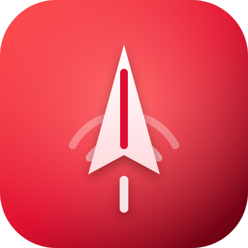
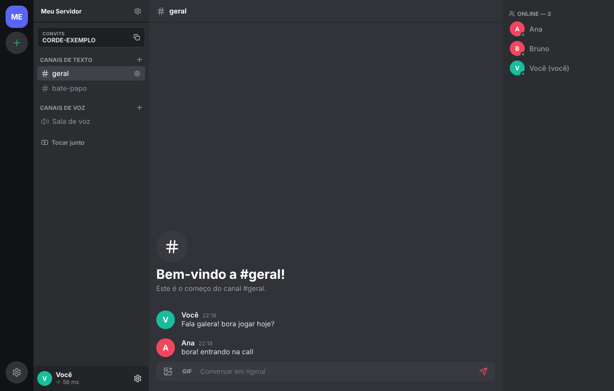
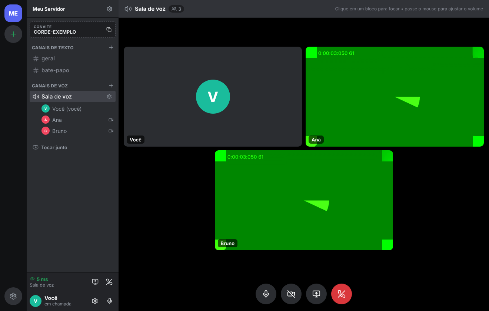
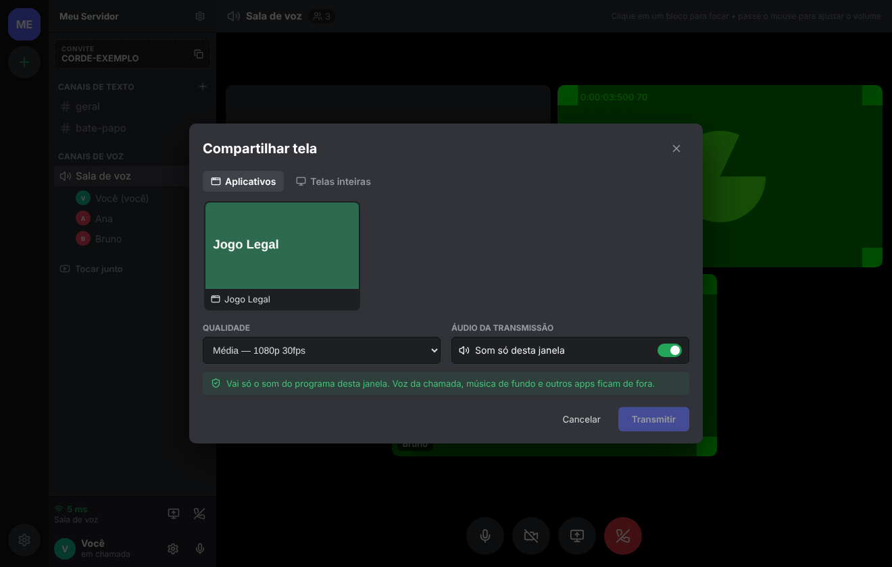
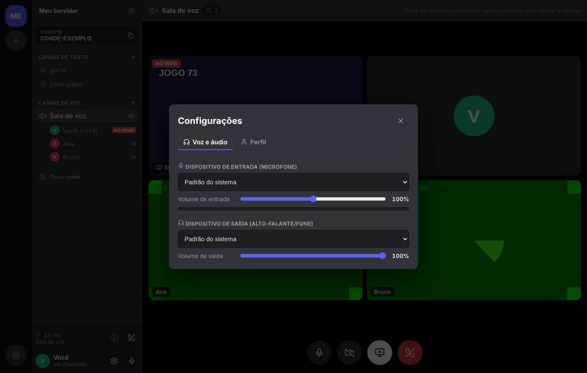
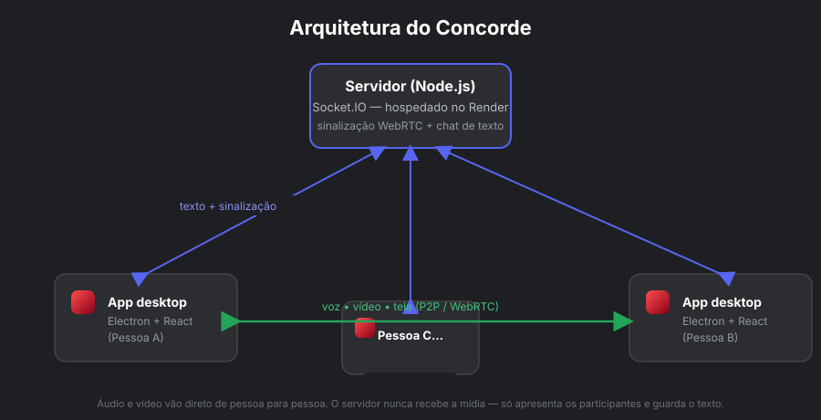

<div align="center">



# Concorde

**Chat de voz, vídeo, texto e transmissão de tela — open source, grátis e auto-hospedável.**

Um "mini Discord" da comunidade: você e seus amigos rodam o **seu próprio
servidor** (de graça) e conversam sem depender de nenhuma empresa.

[Como usar](docs/GUIA_DE_USO.md) · [Hospedar seu servidor](docs/deployment/GUIA_SERVIDOR_PROPRIO_RENDER.md) · [Compilar no Windows](docs/installation/COMPILAR_NO_WINDOWS.md) · [Apoiar via Pix](#apoie-o-concorde-via-pix-)

</div>

> ⚠️ Concorde é um projeto independente e **não é afiliado, patrocinado ou
> associado** ao Discord nem a nenhum outro aplicativo.

---

## O que é

O Concorde é um aplicativo de desktop (Windows) para conversar com amigos por
**voz, vídeo, texto e compartilhamento de tela**, no estilo de servidores e
canais. A diferença é que **o servidor é seu**: qualquer pessoa pode hospedar o
próprio gratuitamente e convidar quem quiser.

**O problema que ele tenta resolver:** ter um espaço de conversa em grupo
simples, sem conta obrigatória em serviços de terceiros, sem anúncios e sem
depender da infraestrutura de ninguém — uma alternativa comunitária e
transparente, onde você controla os dados e o servidor.

## Recursos (implementados e verificados)

- **Vários servidores**: adicione servidores por código de convite e alterne
  entre eles (o app conecta a um por vez).
- **Convites**: cada servidor tem um código curto para compartilhar.
- **Canais de texto e de voz**: criar, renomear e excluir.
- **Membros online e offline** na barra lateral.
- **Foto de perfil** (apelido + imagem) e **identidade do servidor** (nome + ícone).
- **Chat** com texto, imagem/vídeo (até 3 MB) e **GIFs** (via Giphy, com sua chave).
- **Chamada** de voz e vídeo em grupo (malha P2P), com mutar, câmera e **transmissão de tela**.
- **Som só da janela transmitida** (captura por aplicativo no Windows), sem levar
  a voz da chamada junto (sem eco).
- **Dispositivos de áudio** (escolher microfone e saída) e **volumes** separados
  por pessoa (voz e transmissão).
- **Mini player "tocar junto"**: cole um link do YouTube e todos assistem/ouvem
  sincronizado.
- **Indicador de latência (ping)**.

## Capturas

> Imagens de uma instância de demonstração local (nomes e dados fictícios).

| Tela principal | Chamada de voz/vídeo |
|---|---|
|  |  |

| Compartilhar tela | Configurações de áudio |
|---|---|
|  |  |

## Arquitetura



- **App desktop** (Electron + React): a interface que cada pessoa abre.
- **Servidor** (Node.js + Socket.IO): faz a **sinalização** das chamadas e guarda
  o **texto**. É leve e roda no plano gratuito do Render.
- **Mídia P2P (WebRTC)**: a voz, o vídeo e a tela vão **direto de pessoa para
  pessoa**. O servidor nunca recebe a mídia.

> O estado (servidores, canais, mensagens, cadastro de membros) é **mantido em
> memória** no servidor. Se o servidor reiniciar, esses dados são recriados
> conforme as pessoas voltam. Veja "Limitações".

## Como usar

- **Baixar e usar no Windows:** pegue o `Concorde-x.y.z-portable.exe` na página de
  *Releases* do repositório (quando publicada) — é portátil, não instala nada.
  Se ainda não houver release, compile você mesmo (abaixo).
- **Compilar no Windows:** veja **[docs/installation/COMPILAR_NO_WINDOWS.md](docs/installation/COMPILAR_NO_WINDOWS.md)**.
- **Guia de uso do app:** veja **[docs/GUIA_DE_USO.md](docs/GUIA_DE_USO.md)**.

## Criar o seu servidor (grátis)

Você **não** precisa do servidor de ninguém. Suba o seu, de graça, seguindo o
passo a passo para iniciantes:

👉 **[docs/deployment/GUIA_SERVIDOR_PROPRIO_RENDER.md](docs/deployment/GUIA_SERVIDOR_PROPRIO_RENDER.md)**

A configuração automática do Render está em `render.yaml`, na raiz do repositório;
publique o projeto completo no GitHub para usar o Blueprint.

Depois, coloque o endereço do seu servidor no app (na tela de entrada, ou no
arquivo `app/src/config.js` antes de compilar).

## Estrutura do repositório

```
Concorde-Open-Source/
├─ app/            aplicativo desktop (Electron + React + Vite)
├─ server/         servidor Socket.IO (Node.js) — hospede o seu
├─ docs/           documentação, guias e imagens
│  ├─ installation/   compilar no Windows
│  ├─ deployment/     criar servidor próprio no Render
│  ├─ divulgacao/     rascunhos de divulgação
│  └─ images/         capturas e diagrama
├─ scripts/        utilitários (ex.: validar configuração)
├─ release/        onde o executável é gerado (não versionado)
├─ .env.example    variáveis de ambiente do servidor (exemplo)
├─ LICENSE  CONTRIBUTING.md  SECURITY.md  CHECKLIST_PUBLICACAO.md
```

## Configuração

- **App** (`app/src/config.js`):
  - `DEFAULT_SERVER_URL` — endereço do servidor que já vem preenchido no app
    (padrão `http://localhost:3001`; troque pelo endereço do seu servidor).
  - `GIPHY_API_KEY` — **vazio por padrão**. Para habilitar a busca de GIFs, crie
    uma chave **pública** grátis em https://developers.giphy.com e cole aqui. É
    uma chave pública de cliente, não um segredo; mesmo assim, cada pessoa deve
    usar a sua.
  - `ICE_SERVERS` — STUN do Google por padrão; adicione um **TURN** se alguém não
    conseguir conectar (ver guia do servidor).
- **Servidor**: usa só a variável `PORT` (veja `.env.example`). No Render ela é
  definida automaticamente.

## Limitações conhecidas

- **Captura de som por aplicativo** (transmitir só o som de um programa) requer
  **Windows 10 versão 2004 (build 19041) ou mais novo**. Em versões anteriores, a
  transmissão vai sem som.
- **Plano gratuito do Render**: o serviço **hiberna após inatividade** e demora
  alguns segundos para acordar; não há garantia de disponibilidade contínua; as
  condições do plano podem mudar.
- **Estado em memória**: ao reiniciar/hibernar o servidor, servidores/canais/
  mensagens em memória são recriados conforme as pessoas voltam (não há banco de
  dados persistente por padrão).
- **Trocar a saída de áudio** depende de um Chromium/Windows recente.
- **Mini player do YouTube**: é "assistir/ouvir junto" sincronizado — o áudio do
  YouTube **não** entra na chamada; cada pessoa ouve no próprio player.
- O build do executável do Windows deve ser feito **no Windows**.

## Contribuir

Contribuições são bem-vindas! Veja **[CONTRIBUTING.md](CONTRIBUTING.md)** e, para
questões de segurança, **[SECURITY.md](SECURITY.md)**.

## Apoie o Concorde via Pix 💙

O Concorde é um projeto independente e de código aberto. Se ele for útil para você,
considere apoiar voluntariamente seu desenvolvimento e manutenção.

<div align="center">


**Escaneie o QR Code com o aplicativo do seu banco para fazer uma contribuição via Pix.**

Toda contribuição é voluntária. Obrigado por apoiar o Concorde!

</div>

> Antes de confirmar qualquer pagamento, confira no aplicativo do seu banco o nome
> do recebedor e os detalhes exibidos. Este QR Code corresponde ao código Pix
> fornecido pelo mantenedor do projeto.

## Licença

Este projeto é distribuído sob a licença **MIT**. Consulte [LICENSE](LICENSE),
que identifica Eduardo Christian Matias como titular do copyright. Cada
dependência mantém sua própria licença; consulte os avisos de terceiros ao
redistribuir o aplicativo compilado.

## Créditos e agradecimentos

- Construído com [Electron](https://www.electronjs.org/), [React](https://react.dev/),
  [Vite](https://vite.dev/), [Socket.IO](https://socket.io/) e
  [lucide-react](https://lucide.dev/).
- GIFs por [GIPHY](https://giphy.com/) (quando configurado).
- Ícones por [Lucide](https://lucide.dev/).
- Obrigado a toda a comunidade que testar, reportar bugs e contribuir. 💙
